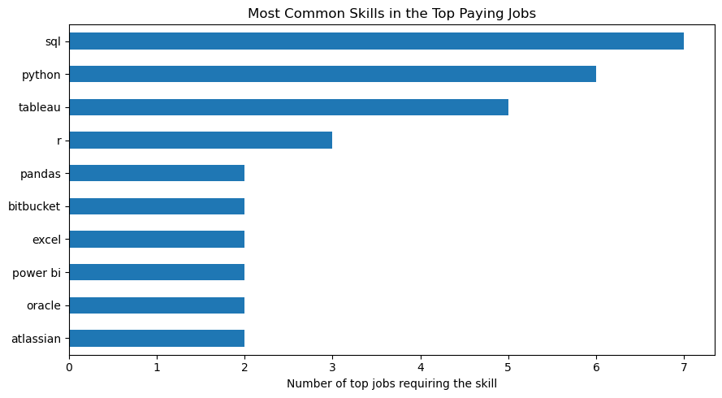
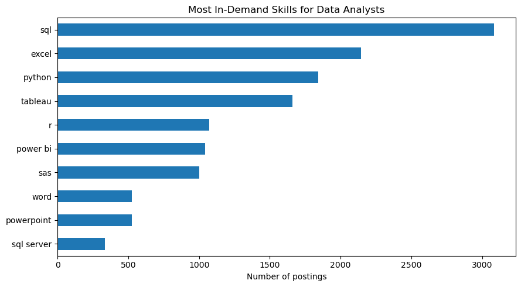

# Introduction
This project examines the data job market, with a main focus on data analyst roles. I explored the top-paying jobs, the top-paying skills, and the skills most in demand. The project is exploratory and aims to help future data analysts decide which skills to learn.

SQL queries and Python code! click link to view: [project_sql folder](/project_sql/)

# Background
This project was created as a way to practice my SQL skills, while also gaining knowledge of which skills are most in demand in top-paying data analyst jobs.

The data was retrieved from Luke Barousse's data analyst course and can be obtained from here: [SQL course](https://lukebarousse.com/sql). This data contains information about data roles around the world, job postings, and skills related to the roles posted.

### Questions I wanted to answer with my SQL queries 

1. What are the top paying data analyst jobs?
2. What are the skills required for the top paying data analyst jobs?
3. What is the related salary with each skills?
4. What are the most in demand skills for data analyst jobs?


# Tools Used
For this project, I used multiple tools to dive deeper into the job market. The tools are listed below.

- **SQL:** Main tool to analyze the data and uncover insights.
- **Jupyter Notebook and Python:** Tools used to create the data visualization.
- **PostgreSQL:** Data management system of choice.
- **Visual Studio Code:** Tool used for SQL queries and database management.
- **Git & GitHub:** Version control and sharing all the work done in the project.

# Analysis
Here are the queries used to answer investigate the data analyst job market here is how I approached each question:

### What are the top paying data analyst jobs?
To answer the question, I filtered the data to remote data analyst roles, converted hourly salaries to yearly salaries, and ranked the roles by average salary. My goal was to highlight the top-paying roles in this field.

```sql 
WITH analyst_remote_jobs AS(
    SELECT *,
    CASE WHEN salary_rate = 'hour' AND job_schedule_type = 'Full-time' THEN salary_hour_avg * 2080 
    WHEN salary_rate = 'year' THEN salary_year_avg
    END AS annual_salary   
    FROM job_postings_fact
    WHERE job_location ='Anywhere'
    AND job_title_short ILIKE '%Data Analyst%'
)

SELECT company_dim.name AS company_name, 
job_title_short, job_location, annual_salary, job_id
FROM analyst_remote_jobs
INNER JOIN company_dim
ON analyst_remote_jobs.company_id = company_dim.company_id
WHERE annual_salary IS NOT NULL
ORDER BY annual_salary DESC
LIMIT 10;
```
Here is the breakdown for the top 10 data analyst jobs in 2023: 

- **Salary Range:** The salary for the top 10 jobs ranged from $189,000 to $650,000. This indicates that there is a huge potential for high salaries in the data analysis field.
- **Employers:** It was observed that the top 5 jobs were from different employers, while the next 5 jobs all came from Braintrust. The top 5 jobs were from Mantys, Meta, Ghritachi, Talent Space, and AT&T. The fact that Braintrust was holding spots 6-10 indicates they could have posted duplicate jobs, so this was removed for the visualization.

| company_name                 | job_title_short   | annual_salary   |
|:-----------------------------|:------------------|:----------------|
| Mantys                       | Data Analyst      | $650,000        |
| Meta                         | Data Analyst      | $336,500        |
| Ghritachi                    | Data Analyst      | $270,400        |
| Talent Space                 | Data Analyst      | $260,000        |
| AT&T                         | Data Analyst      | $255,830        |
| Pinterest Job Advertisements | Data Analyst      | $232,423        |
| Uclahealthcareers            | Data Analyst      | $217,000        |
| SmartAsset                   | Data Analyst      | $205,000        |
| Inclusively                  | Data Analyst      | $189,309        |
| Motional                     | Data Analyst      | $189,000        |
*Table of the top 10 jobs for the data analyst role in remote locations. The table was created using Python.*


### What are the skills required for the top paying data analyst jobs?
I wanted to figure out what were the top skills related to each top paying job. To answer this question I used the previous query from before but expanded from it. Then I added the skills related to the top 10 jobs so I could then count each skill in the top jobs and order it by the skill listed in the top jobs.

```sql
WITH analyst_remote_jobs AS (
    SELECT *,
        CASE
            WHEN salary_rate = 'hour' AND job_schedule_type = 'Full-time' THEN salary_hour_avg * 2080
            WHEN salary_rate = 'year' THEN salary_year_avg
        END AS annual_salary
    FROM job_postings_fact
    WHERE job_location = 'Anywhere'
      AND job_title_short = 'Data Analyst'
),
top_analyst_jobs AS (
    SELECT
        company_dim.name AS company_name,
        analyst_remote_jobs.job_id,
        job_title_short,
        job_location,
        annual_salary
    FROM analyst_remote_jobs
    JOIN company_dim
        ON analyst_remote_jobs.company_id = company_dim.company_id
    WHERE annual_salary IS NOT NULL
    ORDER BY annual_salary DESC
    LIMIT 10
)

SELECT
    top_analyst_jobs.*,
    skills_dim.skills
FROM top_analyst_jobs
LEFT JOIN skills_job_dim ON top_analyst_jobs.job_id = skills_job_dim.job_id
LEFT JOIN skills_dim ON skills_job_dim.skill_id = skills_dim.skill_id
ORDER BY annual_salary DESC;
```

- **Top Skills:** It was discovered that SQL, Python, and Tableau were the top 3 skills associated with the top-paying jobs. SQL led with 7 mentions, Python with 6, and Tableau with 5.


*Skills associated with the top jobs. The plot was created using pandas and Matplotlib in Python.*

### What is the related salary with each skills?
Here, I was looking to find the average salary associated with each skill. I grouped the data by skill and took the average of the salary reported for each one. This applies only to skills associated with data analyst roles, limited to the top 25 skills.

```sql
SELECT skills,ROUND(AVG(T.salary_year_avg),2) AS average_salary
FROM  job_postings_fact AS T
JOIN skills_job_dim AS SJ
ON T.job_id = SJ.job_id
JOIN skills_dim AS SD
ON SJ.skill_id = SD.skill_id
WHERE job_title_short = 'Data Analyst'
    AND salary_year_avg IS NOT NULL
GROUP BY skills
ORDER BY average_salary DESC
LIMIT 25;
```

- **Skill Salaries:** Some of the skills with the highest pay are Golang, Solidity, Couchbase, and DataRobot.
- **Outlier:** SVN was one of the highest-paying skills, with an average salary of $400,000. This seemed like an error, so it was excluded.

| skills       | average_salary   |
|:-------------|:-----------------|
| solidity     | $179,000         |
| couchbase    | $160,515         |
| datarobot    | $155,486         |
| golang       | $155,000         |
| mxnet        | $149,000         |
| dplyr        | $147,633         |
| vmware       | $147,500         |
| terraform    | $146,734         |
| twilio       | $138,500         |
| gitlab       | $134,126         |
| kafka        | $129,999         |
| puppet       | $129,820         |
| keras        | $127,013         |
| pytorch      | $125,226         |
| perl         | $124,686         |
| ansible      | $124,370         |
| hugging face | $123,950         |
| tensorflow   | $120,647         |
| cassandra    | $118,407         |
| notion       | $118,092         |
| atlassian    | $117,966         |
| bitbucket    | $116,712         |
| airflow      | $116,387         |
| scala        | $115,480         |
*Average salary associated with each skill. The same process used for the table above was applied.*

### What are the most in demand skills for data analyst jobs?
For this query, I wanted to find the most in-demand skills for data analysts, regardless of location. This query grouped skills together and counted each occurrence in the overall job postings for data analyst roles.

```sql 
SELECT skills,COUNT(T.job_id) AS skill_occurence
FROM  job_postings_fact AS T
JOIN skills_job_dim AS SJ
ON T.job_id = SJ.job_id
JOIN skills_dim AS SD
ON SJ.skill_id = SD.skill_id
WHERE job_title_short = 'Data Analyst'
    AND salary_year_avg IS NOT NULL
GROUP BY skills
ORDER BY skill_occurence DESC
LIMIT 10;
```
- **Top Skills:** We were able to find that the top skills were SQL, Excel, and Python. This is similar to the skills associated with the top-paying data analyst roles above. This means that those looking to get into the data analyst field should focus on developing these skills.


*Plot of the most in-demand skills for all data analyst job postings across the US.*

[Python code for plots can be found here:](project_sql/data_viz_and_table.ipynb)

# Conclusion

This project explored the data analyst job market, from the highest-paying roles to the skills employers ask for most. Here is what I found:

1. **High earning potential:** Among remote data analyst roles, the top 10 salaries ranged from $189,000 to $650,000, which shows how much room there is to grow in this field. The highest figure came from a single posting, so it should be treated as an upper bound rather than a typical salary.
2. **SQL is essential:** SQL was the most common skill in the top-paying jobs and also among the most in-demand skills across all data analyst postings.
3. **The core skills are consistent:** SQL and Python appeared in both the top-paying jobs and the most in-demand skills, with Tableau and Excel rounding out each list. These are the strongest skills to learn first.
4. **Niche skills pay more:** Skills such as Solidity, Couchbase, DataRobot, and Golang had the highest average salaries. They are less common in job postings, so they work best as specializations added on top of the core skills.

Overall, I would recommend that aspiring data analysts build a strong foundation in SQL, Python, and Excel, then add a specialized skill to stand out and increase earning potential.

### Limitations
The analysis only includes postings that list a salary, and some results rest on small samples. Salary data can also contain errors, as with the SVN outlier I excluded. These results are meant to guide learning priorities, not to predict exact pay.


## Acknowledgments
Huge shout-out to Luke Barousse for the inspiration and for providing the high-quality data.